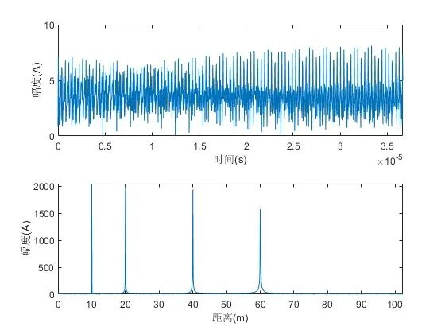
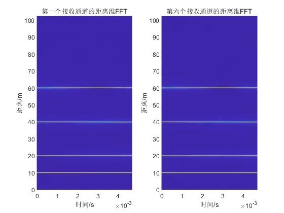
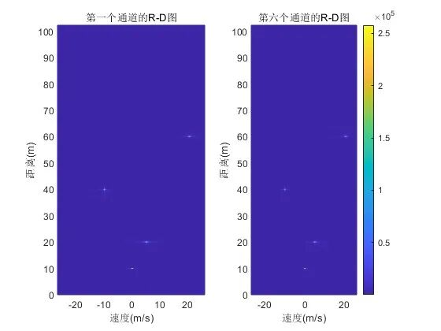
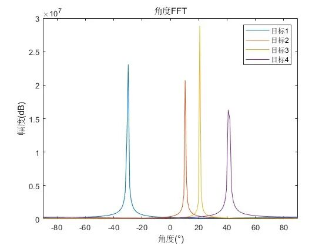
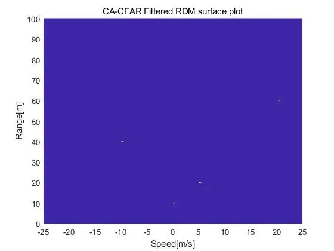

# [Radar Signal Processing]Understand LFMCW Array Radar: Multi-Target Detection Technology from Theory to Simulation[with MATLAB Code]

1. Linear Frequency Modulation Continuous Wave (LFMCW) Radar System Fundamentals and Parameter Design
1.1 Definition of Core Parameters and Formulas
•  
Light speed: The speed at which electromagnetic waves propagate in a vacuum.
•  
Frequency and Wavelength: The starting frequency determines the radar wavelength, with the relationship being:
In the code (common frequency bands for millimeter wave radar), corresponding.
•  
Resolution Distance: Refers to the minimum distance at which radar can distinguish adjacent targets, determined by signal bandwidth.
Therefore, the bandwidth must be met. In the code, it is calculated accordingly.
•  
Frequency sweep time (Chirp period): To avoid distance-Doppler coupling, the Chirp period must be at least 5 to 6 times the maximum detection range corresponding to the round trip delay.
In the code, it is calculated.
•  
Frequency modulation: The rate at which the frequency of a chirp signal changes, as indicated in the code.
•  
Speed resolution and maximum speed: Speed resolution is determined by the number of Chirps:
Maximum measurable speed (without blur):
In the code, it is calculated that...
•  
Array antenna parameters: To avoid angle ambiguity, the antenna spacing must meet (for maximum detection angle). The angle resolution is:
In the code, "...".
1.2 The target model is set in the simulation to include 4 points of interest, each described by distance, speed, and angle:
•  
Distance:
•  
Speed: (negative sign indicates proximity to radar)
•  
Angle:
II. LFMCW Signal Generation and Backscatter Modeling
Among them, the slow time (Chirp-time) is considered.
2.2 Backscatter signal model target backscatter signal needs to consider:
1  
Distance Delay: The target distance varies with time (due to speed), and the round-trip propagation delay is.
2  
Angle-induced path difference: For the ith antenna (position coordinates), the target angle causes an additional path difference and corresponding delay.
Therefore, the signal received by the antenna is:
2.3 The mixing of the intermediate frequency signal is achieved by the conjugate multiplication of the transmitted and received signals, that is. After ignoring the higher order terms, the phase of the mid-frequency signal can be simplified to:
Its frequency includes the beat frequency related to distance (used for distance estimation) and the Doppler shift related to speed (used for speed estimation). The code also includes Gaussian white noise (SNR 20dB) to simulate real-world conditions.
III. Three-Dimensional Signal Processing: Distance - Doppler - Angle Estimation
In the code, each antenna's signal is FFTed in the fast time dimension (...), resulting in a distance spectrum. Figure 1 shows the raw intermediate frequency signal of the first channel and its distance FFT result, with clear peaks corresponding to the target distance.
3.2 Doppler estimation (slow time FFT) caused by target motion, resulting in Doppler shifts in the echo signals from different Chirps, causing phase differences. Perform a Fast Fourier Transform on the slow time dimension (each Chirp), with the peak position corresponding to the Doppler frequency, thereby obtaining the velocity:
After the FFT, perform an FFT on the slow time signal of each distance gate to obtain the Received Delay-Doppler (RDM) matrix. Figure 3 shows the RDM for Channels 1 and 6, allowing simultaneous observation of the target's distance and velocity information.
3.3 Angle Estimation (Array FFT) The phase difference of the received signal by an array antenna is related to the angle: the phase difference between adjacent antennas. Perform FFT on the antenna array dimension (), and the peak position corresponds to the target angle:
The peak frequency of the angle FFT. The code performs an FFT on the array signal in RDM with known distance and velocity for target positions, as shown in Figure 4, which displays the angle spectrum of four targets, consistent with the preset angles.
IV. Object Detection: CA-CFAR algorithm for constant false alarm rate (CFAR) detection is used to distinguish targets from noise in RDM, with the core being adaptive threshold adjustment. The code adopts cell average CFAR (CA-CFAR):
1  
Sliding window: Each detection unit (CUT) is surrounded by training units (estimating noise) and protection units (avoiding target energy interference).
2  
Noise Estimation: The average energy of the training units as a measure of noise level.
3  
Threshold calculation: (for false alarm rate control parameter).
4  
Judgment: If the CUT energy exceeds the threshold, it is determined to be a target.
Figure 5 shows the RDM after CA-CFAR processing, effectively suppressing noise while preserving target locations.
V. Summary: This simulation fully realizes the distance, velocity, and angle estimation of multiple targets for an LFMCW array radar through parameter design, signal modeling, three-dimensional FFT processing, and CFAR detection. Theoretically, each step is rigorously derived through formulas; in practice, the code achieves three-dimensional parameter decoupling through fast time, slow time, and array dimension FFT, ultimately accurately extracting target information. This process embodies the core technology route of LFMCW radar "Frequency Modulation Continuous Wave + Array Processing," providing a theoretical and simulation foundation for actual radar system design.
End

## Images

<!-- PAYMENT_BLOCK -->

## Get this dataset

- Payment link (Stripe): [Buy now](https://buy.stripe.com/3cs8yP7sY87d0vu9AB)
- Payment QR code: 

<!-- /PAYMENT_BLOCK -->
